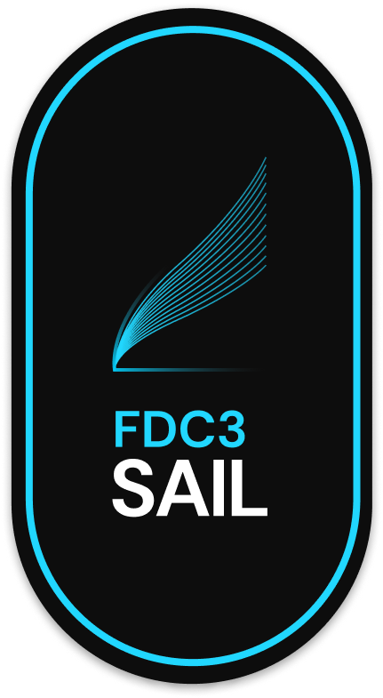
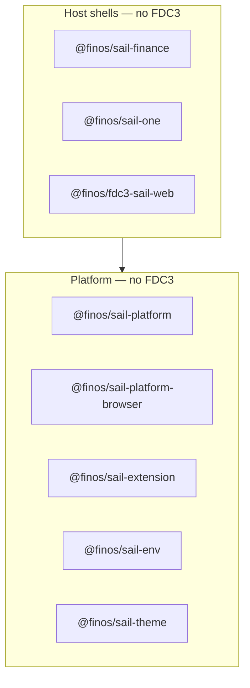
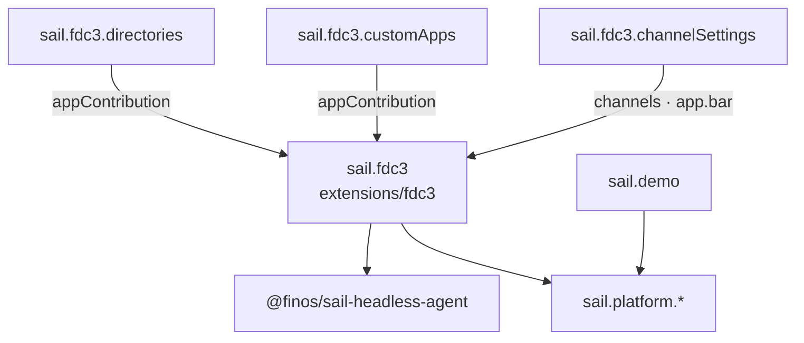

<p align="center">
    
</p>

<h1 align="center">FDC3 Sail</h1>

<h3 align="center">Develop easier. &nbsp; Build faster. &nbsp; Integrate quicker.</h3>

<br />

<div align="center">

[](https://finosfoundation.atlassian.net/wiki/display/FINOS/Incubating)
[](https://github.com/finos/fdc3-sail/blob/main/LICENSE)

[](https://github.com/finos/fdc3-sail)

<br />

[](https://github.com/finos/FDC3-Sail/actions/workflows/ci.yml)
[](https://bestpractices.coreinfrastructure.org/projects/12272)
[](https://scorecard.dev/viewer/?uri=github.com/finos/FDC3-Sail)
[](https://github.com/finos/FDC3-Sail/actions/workflows/semgrep.yml)
[](https://github.com/finos/FDC3-Sail/actions/workflows/ql.yml)
[](https://github.com/finos/FDC3-Sail/actions/workflows/cve-scanning.yml)

</div>

## What is FDC3 Sail?

 - If you are new to FDC3, start with the [FDC3 website](https://fdc3.finos.org).
 - If you want to try FDC3 Sail in your browser, [start here](https://sail.fdc3.finos.org).

FDC3 Sail is an open source implementation of the [FDC3](https://fdc3.finos.org) interoperability standard. The supported product path is a **browser-resident Desktop Agent** assembled as:

1. **Host shells** — UI and workspace chrome only (`sail-finance`, `sail-one`, and the older `sail-v2-web`). They compose `@finos/sail-platform` and load extensions; they do **not** own FDC3 protocol types, DACP/WCP, or App Directory logic.
2. **Platform** — session, bus, catalog, storage, and extension contribution points (`@finos/sail-platform`, `@finos/sail-platform-browser`, `@finos/sail-extension`). No FDC3.
3. **FDC3 as an extension** — `sail.fdc3` (`@finos/sail-extension-fdc3`) wraps `@finos/sail-headless-agent` for FDC3 2.2 / 3.0 DACP; WCP / `MessagePort` attach via `sail.ui.hidden`. Related extensions (`directories`, `custom-apps`, `channels`) contribute apps and channel UI into that FDC3 surface.

For package ownership, entry points, and what's implemented vs. planned, see the [Architecture Overview](https://fdc3-sail.finos.org/docs/architecture/overview); this README does not repeat it.

### Packages

Host shells compose the platform only. They do **not** import the FDC3 engine; FDC3 arrives by loading extensions at runtime.



| Package | Role |
|---|---|
| [`packages/sail-finance`](packages/sail-finance/) | Example host — finance workspace UI |
| [`packages/sail-one`](packages/sail-one/) | Example host — domain-neutral tab-and-grid UI |
| [`packages/sail-v2-web`](packages/sail-v2-web/) | Previous Socket.IO host UI (still runnable) |
| [`packages/sail-platform`](packages/sail-platform/) | Session, bus, catalog, storage, UI contribution points |
| [`packages/sail-platform-browser`](packages/sail-platform-browser/) | Browser session host hooks |
| [`packages/sail-extension`](packages/sail-extension/) | Extension runtime — activate, registry, contributes |
| [`packages/sail-env`](packages/sail-env/README.md) | Shared host bootstrap — query params and Vite env |
| [`packages/sail-theme`](packages/sail-theme/) | Shared brand theme |
| [`packages/sail-headless-agent`](packages/sail-headless-agent/) | FDC3 engine — used by `sail.fdc3`, not by hosts |
| [`packages/sail-conformance-harness`](packages/sail-conformance-harness/) | Playwright runner for FINOS FDC3 conformance |

### Extensions

FDC3 lives here. Hosts load these via the extension runtime; satellite extensions depend on `sail.fdc3` exports (e.g. `appContribution`, `channels`).



| Extension | Id | Role |
|---|---|---|
| [`extensions/fdc3`](extensions/fdc3/) | `sail.fdc3` | Per-session factory, middleware, WCP, channels API, app contribution registry |
| [`extensions/fdc3-directories`](extensions/fdc3-directories/) | `sail.fdc3.directories` | AppD URLs → `sail.fdc3.appContribution` |
| [`extensions/fdc3-custom-apps`](extensions/fdc3-custom-apps/) | `sail.fdc3.customApps` | Inline apps → `sail.fdc3.appContribution` |
| [`extensions/fdc3-channels`](extensions/fdc3-channels/) | `sail.fdc3.channelSettings` | User-channel catalog + app-bar UI on `sail.fdc3.channels` |
| [`extensions/demo`](extensions/demo/) | `sail.demo` | Sample bus message-log extension |

Full documentation, including per-package guides, lives at **[https://fdc3-sail.finos.org](https://fdc3-sail.finos.org)** (built from [`website/`](website/) via Netlify).

## Prerequisites

- **Node.js** >= 24.x
- **npm** >= 11.x

## Quick Start

### Clone the Repository

```bash
git clone https://github.com/finos/FDC3-Sail.git
cd FDC3-Sail
npm install
```

### Running the browser shells (current path)

```bash
npm run dev
```

Open http://localhost:3000. FDC3 apps in iframes connect via WCP. Use `npm run dev:one` for the `sail-one` shell.

### Running the previous Sail UI

```bash
npm run dev:v2
```

Starts the Socket.IO-based host in `packages/sail-v2-web`. FDC3 still comes from `sail.fdc3` / `sail-headless-agent`, not from the shell itself.

### Conformance harness

```bash
npm run dev:browser:2.2 -w @finos/sail-conformance-harness
npm run dev:browser:3.0 -w @finos/sail-conformance-harness
```

Open http://localhost:3001. Unattended runs:

```bash
npm run test:browser:2.2 -w @finos/sail-conformance-harness
npm run test:browser:3.0 -w @finos/sail-conformance-harness
```

(Playwright selects suite **All**, clicks **Run**, scrapes `#mocha` until Mocha ends.)

See the [Development Guide](https://fdc3-sail.finos.org/docs/development) for the full command reference.

## Development

Environment setup, build/test/lint/typecheck, quality gates, and publishing are documented in the [Development Guide](https://fdc3-sail.finos.org/docs/development), not in this README.

Engine behavior for FDC3 2.2 and 3.0 is covered by Cucumber in `packages/sail-headless-agent` (`npm run test -w @finos/sail-headless-agent`).

## Meetings

FDC3 Sail holds regular project meetings to discuss development progress, roadmap, and community contributions.

- [Join FDC3 Sail Meeting](https://zoom-lfx.platform.linuxfoundation.org/meeting/95252800112?password=90638454-991c-4ab0-8aed-791fc372623c)
- [Register for the meeting series (calendar invite)](https://zoom-lfx.platform.linuxfoundation.org/meeting/95252800112?password=90638454-991c-4ab0-8aed-791fc372623c&invite=true)

Meeting agendas and minutes are tracked through GitHub issues with the `meeting` label.

## Status

FDC3 Sail targets [FDC3 2.2](https://fdc3.finos.org/docs/api/spec) conformance and is extending toward FDC3 3.0 via `sail-headless-agent`'s versioned handlers. It is in active development and **not yet ready for production use**. Contributions and bug reports are welcome.

## Mailing List

To join the FDC3 Sail mailing list please email [fdc3-sail+subscribe@lists.finos.org](mailto:fdc3-sail+subscribe@lists.finos.org).

## Other FDC3 desktop agents

FDC3 is an open standard; other desktop agents are listed on the [FDC3 website](https://fdc3.finos.org). Sail is one open-source implementation — you can use another agent with the same FDC3 apps where supported.

## Contributing

1. Fork it (<https://github.com/finos/fdc3-sail/fork>)
2. Create your feature branch (`git checkout -b feature/fooBar`)
3. Read our [contribution guidelines](CONTRIBUTING.md) and [Community Code of Conduct](https://www.finos.org/code-of-conduct)
4. Commit your changes (`git commit -am 'Add some fooBar'`)
5. Push to the branch (`git push origin feature/fooBar`)
6. Create a new Pull Request

See the [Development Guide](https://fdc3-sail.finos.org/docs/development) for environment setup and the commands to run before opening a PR.

_NOTE:_ Commits and pull requests to FINOS repositories will only be accepted from those contributors with an active, executed Individual Contributor License Agreement (ICLA) with FINOS OR who are covered under an existing and active Corporate Contribution License Agreement (CCLA) executed with FINOS. Commits from individuals not covered under an ICLA or CCLA will be flagged and blocked by the FINOS Clabot tool (or [EasyCLA](https://github.com/finos/community/blob/master/governance/Software-Projects/EasyCLA.md)). Please note that some CCLAs require individuals/employees to be explicitly named on the CCLA.

_Need an ICLA? Unsure if you are covered under an existing CCLA? Email [help@finos.org](mailto:help@finos.org)_

### Emeritus contributors

- [Nick Kolba](https://github.com/nkolba) contributed the first version of FDC3-Sail, initially called "FDC3 Electron", in 2022.
- [Seb M'Barek](https://github.com/sebbenmbarek) and Nick Kolba renamed the project to FDC3-Sail and presented it at [OSFF New York in 2023](https://www.youtube.com/watch?v=dKDkOk3btWU).

## License

Copyright 2022–2026 [FINOS](https://www.finos.org/)

Distributed under the [Apache License, Version 2.0](http://www.apache.org/licenses/LICENSE-2.0).

SPDX-License-Identifier: [Apache-2.0](https://spdx.org/licenses/Apache-2.0)
