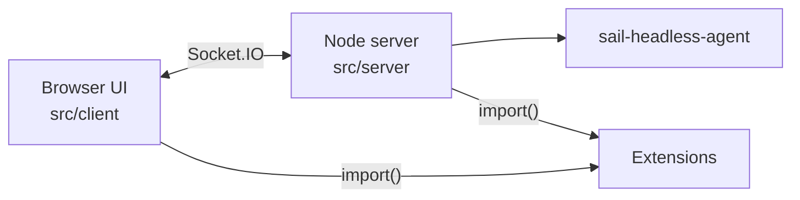

# @finos/fdc3-sail-web (`packages/sail-v2-web`)

The previous Socket.IO Sail UI. A Node server runs the Desktop Agent
(`sail-headless-agent`) and the browser UI talks to it over Socket.IO.



```bash
npm run dev:v2                     # from the repo root, http://localhost:8090
```

## Extensions

`SAIL_EXTENSION_URLS` is a comma-separated list of extension module URLs. Set it in the
shell or in `packages/sail-v2-web/.env`. The server and the browser read the same value.
When it's unset, Sail loads the demo extensions at `http://localhost:9100/src/index.ts`
and `http://localhost:9101/src/index.ts`. Entries that aren't `http(s)` URLs are skipped
with a warning.

```bash
# local
SAIL_EXTENSION_URLS=http://localhost:3000/sail-extension/index.js

# remote
SAIL_EXTENSION_URLS=https://<engine-host>/sail-extension/index.js

# several
SAIL_EXTENSION_URLS=http://localhost:9100/src/index.ts,http://localhost:3000/sail-extension/index.js
```

- The server loads extensions when it starts, so start the engine first, or restart Sail
  once the engine is up.
- The browser list is fixed when Vite builds the UI. For a production build, set the
  variable before building as well as before starting the server.
- A Sail served over `https` can't load an `http` extension (mixed content), so a remote
  engine must use `https`.

## Folders

| Folder        | What's in it                                      |
| ------------- | ------------------------------------------------- |
| `src/server/` | Node server: Desktop Agent, Socket.IO, extensions |
| `src/client/` | Browser UI                                        |
| `src/common/` | State and message types shared by server and client |
| `src/app/`    | Pages embedded in apps (channel selector, resolver) |
| `html/`       | Page entry points                                 |
| `test/`       | Unit tests                                        |
