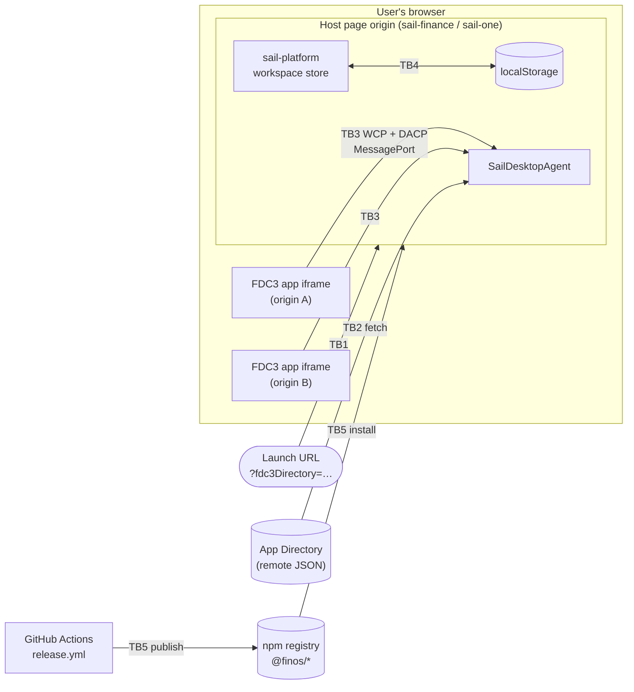

# Threat model and security self-assessment

This page is FDC3 Sail's project-wide security assessment. It lists the most likely and most
damaging things that could go wrong, what already stops them, and what is still open. It meets
[OSPS Baseline](https://baseline.openssf.org/) control **OSPS-SA-03.01**.

| | |
|---|---|
| **Scope** | v3 browser host: `@finos/sail-browser-agent`, `@finos/sail-platform`, the `sail-finance` and `sail-one` example shells, and the release pipeline. The legacy v2 Socket.IO app is covered briefly. |
| **Method** | Trust boundaries from the [architecture overview](./overview), then STRIDE threats per boundary, rated by likelihood × impact. |
| **Last reviewed** | 2026-11-12, against `v3.0.0-beta.1` |
| **Review cadence** | Every major or minor release, and whenever a trust boundary changes. |

Status markers follow the [overview convention](./overview#status-markers): **`[implemented]`**
means the code does it today; **gap** means it does not.

## System and trust boundaries

| Boundary | Crosses from → to | What crosses it |
|---|---|---|
| **TB1** | Whoever wrote the link → host page | Query parameters (`fdc3Directory`, `appId`, `noSplash`) |
| **TB2** | Directory server → agent | The list of apps allowed to connect |
| **TB3** | App iframe (any origin) → agent | WCP handshake, then DACP requests: broadcasts, intents, channel joins |
| **TB4** | Host origin's storage → workspace store | Saved workspaces, layouts, channel choices |
| **TB5** | Contributors and dependencies → published packages → integrators | Source, dependencies, npm tarballs |

**Assets worth protecting:** the context data apps share (often client or trading data), the
integrity of the app list (who is admitted), the host page itself (anything running there controls
the agent), and the integrity of the published `@finos/*` packages.

## Ranked threats

Ratings: **L**ow / **M**edium / **H**igh. Ranked by likelihood × impact, most serious first.

| # | Threat | STRIDE | Boundary | Likelihood | Impact | Status |
|---|---|---|---|---|---|---|
| T1 | Directory override via crafted launch link | Spoofing, Elevation | TB1, TB2 | M | H | **gap** |
| T2 | A malicious or compromised app in the directory reads shared context | Info disclosure | TB3 | M | H | partly mitigated |
| T3 | Compromised dependency or release | Tampering | TB5 | M | H | partly mitigated |
| T4 | Malformed DACP messages are processed by default | Tampering, DoS | TB3 | M | M | **gap** |
| T5 | Intent auto-resolves to an unintended app | Info disclosure | TB3 | M | M | by design; host can mitigate |
| T6 | Script injection on the host page | Elevation | host origin | L | H | partly mitigated |
| T7 | App impersonates another app's origin | Spoofing | TB3 | L | H | **`[implemented]`** mitigation |
| T8 | Tampered workspace in localStorage | Tampering | TB4 | L | M | partly mitigated |
| T9 | Legacy v2 Socket.IO server accepts any connection | Spoofing, DoS | v2 only | L | M | out of v3 scope |

### T1 — Directory override via crafted launch link

**What could happen.** Both example shells read `?fdc3Directory=` from the page URL and, when it is
present, use it *instead of* the configured directory (`resolveSoleFdc3Directory` in
`packages/sail-env/src/index.ts`; used by `sail-finance/src/main.tsx` and `sail-one/src/index.tsx`).
The directory is the admission list (see [App admission](./security)), so anyone who can get a user
to click a link to a real Sail deployment can choose which apps that session admits. Attacker apps
then run inside a trusted-looking host, under its brand and URL.

**What stops it today.** A deployment's Content-Security-Policy `frame-src` still limits which
origins can be framed, so attacker apps on unlisted origins will not load. The override is not part
of `@finos/sail-browser-agent`; it is shell behaviour.

**Gap and recommendation.** Make the query override opt-in (off in production builds), or restrict it
to an allowlist of directory hosts. Integrators building their own host should not copy this pattern
without that guard.

### T2 — Malicious or compromised app in the directory

**What could happen.** Once admitted, an app can join user channels, receive every broadcast on them,
listen for intents and raise them. FDC3 has no per-app permission model, so an admitted app sees what
any other admitted app on the same channel sees. A legitimate app whose own site is compromised
behaves the same way.

**What stops it today.** `[implemented]` Only directory entries are admitted, and origins are checked
(T7). Context is only delivered to apps on the same channel or chosen as an intent target.

**Residual risk.** Accepted, and inherent to FDC3. Deployments must vet directory entries and serve
apps over HTTPS ([App admission — what a deployment should do](./security#what-a-deployment-should-do-instead)).

### T3 — Compromised dependency or release

**What could happen.** A malicious dependency update, a compromised GitHub Action, or a leaked npm
token puts hostile code into `@finos/sail-browser-agent` or `@finos/sail-platform`, which then runs
inside every integrator's host page.

**What stops it today.** `[implemented]`

- `@finos/sail-platform` has zero runtime dependencies; `@finos/sail-browser-agent` depends only on
  `@finos/fdc3` and `@finos/fdc3-schema`.
- PRs run GitHub Dependency Review, CodeQL, Semgrep, zizmor (workflow linting) and CVE scanning.
  OpenSSF Scorecard runs on `main`.
- Third-party Actions are pinned to commit SHAs.
- Publishing happens only from `release.yml` on `main`, through Changesets.

**Gap and recommendation.** Publishing uses a long-lived `NPM_TOKEN`, and npm provenance is not
switched on. Move to npm trusted publishing (OIDC — `id-token: write` is already granted) and publish
with provenance, so integrators can check where a tarball came from.

### T4 — Malformed DACP messages processed by default

**What could happen.** Inbound DACP and WCP messages are checked against the FDC3 schema
(`app-connection/inbound-validation.ts`), but the default mode is `"warn"`: an invalid message is
logged and then handled anyway. A buggy or hostile app can send malformed requests that reach
handlers which assume valid shapes. The worst likely result is errors or a stuck agent in that tab
(denial of service), not cross-app access.

**What stops it today.** Handlers dispatch on known message types. Hosts can pass
`validation: "strict"` to reject invalid messages.

**Gap and recommendation.** Make `"strict"` the default once the conformance suite passes under it,
and add rate or size limits per connection.

### T5 — Intent auto-resolves to an unintended app

**What could happen.** If a host omits `intentResolver`, the agent picks the first handler for a
raised intent. The context payload goes to that app without the user choosing it. If T2 applies, the
payload goes to an attacker app.

**What stops it today.** Both example shells show a resolver UI so the user picks the target.
`sail-one` skips it when built with `VITE_AUTO_RESOLVE=1`, which is meant for tests only. The
default is documented in the [host-contract surface](./overview#host-contract-surface).

**Recommendation.** Integrators handling sensitive data should always supply an `intentResolver`.

### T6 — Script injection on the host page

**What could happen.** Any script running on the host origin controls the agent directly: it can read
all context, rewrite the app list and fake user choices.

**What stops it today.** The shells are React apps, which escape rendered text by default. Apps run in
iframes on their own origins, so a compromised app cannot reach the host page's DOM.

**Recommendation.** Deployments should set a strict Content-Security-Policy (`script-src`,
`frame-src`) on the host page, as already advised in [App admission](./security).

### T7 — App impersonates another app's origin

**What stops it.** `[implemented]` WCP4 identity validation requires `identityUrl`, `actualUrl` and the
`WCP1Hello` `MessageEvent.origin` to match, and the app to be in the directory. Both checks fail
closed. Details in [App admission](./security#what-the-desktop-agent-enforces-implemented).

**Residual risk.** Low. Origin identity is only meaningful over HTTPS.

### T8 — Tampered workspace in localStorage

**What could happen.** Saved workspaces live in the host origin's `localStorage` by default
(`sail-platform/src/storage/local.ts`). Anything that can write there (T6, or local access to the
machine) can change which apps a saved workspace reopens.

**What stops it today.** Launching still goes through the agent's directory, so a tampered workspace
cannot admit an app the directory does not list. The data is not encrypted and should not hold
secrets.

### T9 — Legacy v2 Socket.IO server

**What could happen.** `sail-v2-web` runs an Express + Socket.IO server that accepts any connection
without authentication (`src/server/da/initSailSocketIOService.ts`). If it is exposed beyond
localhost, anyone who can reach it can talk to the agent.

**Status.** Out of scope for the v3 browser host, which has no server. v2 is kept runnable for
comparison only and should not be deployed on a shared network.

## Follow-up work

Tracked in [#485](https://github.com/finos/FDC3-Sail/issues/485).

| Threat | Action | Owner |
|---|---|---|
| T1 | Gate or allowlist `?fdc3Directory=` in the shells | maintainers |
| T3 | Switch to npm trusted publishing with provenance | maintainers |
| T4 | Default inbound validation to `"strict"` | maintainers |

Report suspected vulnerabilities privately, as described in [SECURITY.md](https://github.com/finos/FDC3-Sail/blob/main/SECURITY.md).

## Related

- [App admission and origin trust](./security) — the WCP4 checks in detail, and deployment advice.
- [Architecture overview](./overview) — packages, host contracts and the connection model.
- [`security-insights.yml`](https://github.com/finos/FDC3-Sail/blob/main/security-insights.yml) — links here as the project's self-assessment.
