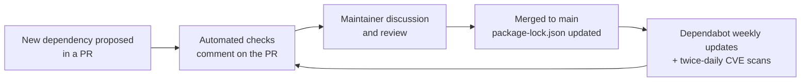

# Development Guide

This guide is for **contributors** who clone the FDC3-Sail monorepo and work on Sail packages, tests, and documentation.

If you want to **run the Sail platform** without contributing, see [Run Sail](./run-sail). If you want to **embed a Desktop Agent in your own web app**, see [Getting Started](./getting-started).

For the contribution process, CLA requirements, and project governance (maintainer roles and voting), see [CONTRIBUTING.md](https://github.com/finos/FDC3-Sail/blob/main/CONTRIBUTING.md) in the repository — this guide covers only the technical side: environment setup, commands, and code quality gates.

## Prerequisites

- Node.js **24+**
- npm **11+**

```bash
nvm use 24
```

## Clone and install

```bash
git clone https://github.com/finos/FDC3-Sail.git
cd FDC3-Sail
npm install
```

Always install from the **repository root**. Shared dev tooling (TypeScript, Vite, Vitest, ESLint, Prettier, and React type packages) lives in the root `package.json` and is hoisted for all workspaces. Workspace packages only declare package-specific dev dependencies (for example Cucumber in `@finos/sail-browser-agent` or Playwright in `@finos/sail-finance`). Run workspace scripts with `npm run <script> -w <workspace>` from the root — do not `cd` into a package and run `npm install` there.

### Run the full stack locally

```bash
npm run dev
```

Starts Desktop Agent (watch), platform API (watch), and Sail web UI on **http://localhost:3000**.

```bash
npm run dev:browser:2.2 -w @finos/sail-conformance-harness   # FDC3 2.2 toolbox on :3001
npm run dev:browser:3.0 -w @finos/sail-conformance-harness   # FDC3 3.0 toolbox on :3001
npm run docs:dev          # Documentation site (use --port 3002 if web app is running)
```

## Project Structure

FDC3 Sail is an npm workspace monorepo:

```
FDC3-Sail/
├── packages/
│   ├── sail-headless-agent/ # DACP engine + Cucumber BDD (v2/ and v3/)
│   ├── sail-browser-agent/  # WCP browser host (@finos/sail-browser-agent)
│   ├── sail-platform/       # Workspaces / layouts (@finos/sail-platform)
│   ├── sail-env/            # Host bootstrap helpers (@finos/sail-env)
│   ├── sail-theme/          # Brand tokens + assets
│   ├── sail-finance/        # Finance example shell
│   ├── sail-one/            # Domain-neutral example shell
│   ├── sail-v2-web/         # Previous Socket.IO UI (@finos/fdc3-sail-web)
│   └── sail-conformance-harness/  # FINOS toolbox Playwright runner
└── website/                 # Documentation (Docusaurus)
```

See [Packages overview](./packages/overview) for the dependency diagram.

## Internal and Development Packages

- [@finos/sail-headless-agent](./packages/headless-agent/overview) — engine + [BDD inventory](./packages/headless-agent/bdd)
- [@finos/sail-conformance-harness](./packages/conformance-harness/overview) — FINOS toolbox against `sail-one`, `sail-finance`, `sail-v2-web`
- [@finos/sail-env](./packages/sail-env/overview) — shared host query/env helpers
- [@finos/fdc3-sail-web](./packages/sail-v2-web/overview) — previous Socket.IO shell (still a conformance host)

## Common Commands

### Development

```bash
# Start browser-based development (most common) — sail-finance shell
npm run dev

# Same, but with the sail-one shell instead of sail-finance
npm run dev:one

# FDC3 conformance toolbox host (2.2 or 3.0)
npm run dev:browser:2.2 -w @finos/sail-conformance-harness
npm run dev:browser:3.0 -w @finos/sail-conformance-harness

# Start documentation site
npm run docs:dev
```

### Code Quality

```bash
# Run all quality checks (recommended before commits)
npm run validate

# Type checking
npm run typecheck

# Linting
npm run lint
npm run lint:fix

# Formatting
npm run format
npm run format:fix
```

### Testing

```bash
# Unit tests (Vitest) - watch mode
npm run test

# Run tests once
npm test -- --run

# Desktop Agent unit tests
npm test -w @finos/sail-browser-agent

# FDC3 DACP BDD — features under sail-headless-agent test/features/v2/ and v3/
npm test -w @finos/sail-headless-agent

# FINOS toolbox in Playwright (2.2 and 3.0)
npm run test:browser:2.2 -w @finos/sail-conformance-harness
npm run test:browser:3.0 -w @finos/sail-conformance-harness
```

### Testing policy

New major functionality MUST come with automated tests in the same pull request. Bug fixes SHOULD add a test that fails without the fix. Pick the suite that matches the change:

| Change | Suite | Where tests go |
| --- | --- | --- |
| Logic in a package (functions, stores, UI helpers) | Vitest | `*.test.ts` beside the code, or the package's `test/` folder |
| FDC3 Desktop Agent behaviour (DACP messages, intents, channels) | Cucumber | `.feature` files in `packages/sail-headless-agent/test/features/v2/` or `v3/` |
| End-to-end FDC3 conformance against a running host | Playwright + FINOS toolbox | `packages/sail-conformance-harness/e2e/` |

Vitest and Cucumber run in `npm run validate` and CI on every pull request. The Playwright conformance suite runs in its own CI workflow (`.github/workflows/conformance.yml`).

#### Coverage

| Rule | Level | Checked by |
| --- | --- | --- |
| New and changed lines in a pull request are covered by tests | at least 80% | Codecov `patch` check on the PR |
| Overall coverage doesn't drop | no more than 1% lower | Codecov `project` check on the PR |
| Overall coverage stays above the floor | floor set in `vitest.config.ts` | `npm test -- --run --coverage` in CI |

The project's goal is 80% statement coverage overall ([OpenSSF Best Practices `test_statement_coverage80`](https://www.bestpractices.dev/en/criteria/2#2.test_statement_coverage80)). When coverage rises, raise the floor in `vitest.config.ts` to match.

Run coverage locally:

```bash
npm run build
npm test -- --run --coverage   # summary in the terminal, full report in coverage/
```

The Vitest coverage report does not yet include `sail-headless-agent` (tested by Cucumber) or `sail-conformance-harness` (a test suite itself).

### Building

```bash
# Build publishable / CI workspaces
npm run build

# Documentation site
npm run docs:build

# Build specific workspace
npm run build --workspace=@finos/sail-platform

# Clean build artifacts
npm run clean
```

## Code Submission Process

### Before You Start

1. **Check for existing issues** - Search GitHub issues for related work
2. **Create an issue** - Describe your proposed changes and get feedback
3. **Fork the repository** - Create your own copy to work in

### Making Changes

#### 1. Create a Feature Branch

```bash
git checkout -b feature/your-feature-name
# or
git checkout -b fix/your-bug-fix
```

#### 2. Development Standards

**Code Quality Requirements:**

Run `npm run validate` before commits. It runs the same gate as CI: format, build, lint (including package-boundary import rules), typecheck, docs conformance inventory, docs build, Vitest (`npm test -- --run`), and Cucumber (`npm run test:cucumber -w @finos/sail-browser-agent`).

Individual steps when iterating:

- `npm run lint` / `npm run lint:fix`
- `npm run typecheck`
- `npm run format` / `npm run format:fix`
- `npm run build` (CI workspaces)
- `npm run docs:build`

#### 3. Quality Check Before Submission

```bash
# Run this before every commit (full CI gate)
npm run validate

# If a step fails, fix and re-run validate:
npm run lint:fix      # Lint
npm run format:fix    # Format
# Fix type errors manually, then:
npm run validate
```

### Commit Message Format

```bash
type: brief description

- More detailed explanation if needed
- Use bullet points for multiple changes
- Reference issue numbers: Fixes #123
```

**Common types:**
- `feat:` - New features
- `fix:` - Bug fixes
- `docs:` - Documentation changes
- `refactor:` - Code restructuring
- `test:` - Adding or updating tests
- `chore:` - Maintenance tasks

## Key Technologies

- **TypeScript** - Type-safe JavaScript
- **React 19** - UI framework
- **Zustand** - State management
- **Dockview** - Workspace layout management
- **Tailwind CSS** - Styling
- **Vite** - Build tool
- **Vitest** - Testing framework
- **Cucumber** - BDD testing for FDC3 compliance

## Dependency management

How the project selects, obtains and tracks its third-party dependencies. The key words MUST and SHOULD are used as described in [RFC 2119](https://www.rfc-editor.org/rfc/rfc2119).



### Selecting

Every new dependency MUST be raised for discussion in the pull request that adds it. Expect it to be questioned: the default answer is "do we need it?".

When deciding, maintainers consider whether the dependency:

- SHOULD be needed at all: a built-in Node.js or browser API, or an existing dependency, cannot reasonably do the job;
- SHOULD have a licence compatible with Apache-2.0, ideally FINOS [Category A or B](https://community.finos.org/docs/governance/Software-Projects/license-categories);
- SHOULD be actively maintained, with no unresolved critical advisories;
- SHOULD be widely used or come from a trusted publisher, ideally published with npm provenance.

These are guidelines, not hard gates. A dependency that misses one can still be accepted if the PR explains why.

### Obtaining

- All npm packages come from the public npm registry and are installed from the **repository root** (npm workspaces).
- `package-lock.json` is committed and pins the exact version and integrity hash of every direct and transitive dependency. CI and releases install with `npm ci`, so builds use exactly the locked versions.
- `overrides` in the root `package.json` force patched versions of transitive dependencies when upstream has not released a fix.
- GitHub Actions are pinned to full commit SHAs.

### Tracking and updating

| What | Tool | Result |
| --- | --- | --- |
| Version updates (npm and GitHub Actions) | Dependabot (`.github/dependabot.yml`) | Weekly PRs; minor/patch grouped, majors separate |
| New vulnerable dependencies | GitHub Dependency Review (`dependency-review.yml`) | ❌ Fails the PR |
| Licence outside the allowed list | GitHub Dependency Review (`dependency-review.yml`) | ⚠️ Warning, for discussion |
| Low OpenSSF Scorecard (below 3) | GitHub Dependency Review (`dependency-review.yml`) | ⚠️ Warning |
| Lost npm provenance or trusted publishing | [provenance-action](https://github.com/danielroe/provenance-action) (`dependency-review.yml`) | ❌ Fails the PR |
| New packages, size growth, native or lighter alternatives | [e18e dependency diff](https://github.com/e18e/action-dependency-diff) (`dependency-diff.yml`) | 💬 PR comment |
| Known CVEs and malicious packages | `npm audit` + OSV-Scanner (`cve-scanning.yml`) | ❌ Fails on critical or malicious; runs on PRs, `main` and twice daily |
| Unused dependencies | Knip (`npm run knip`) | Report on every CI run |

The PR checks run on every pull request that changes a `package.json` or `package-lock.json`, including Dependabot and fork PRs. Dependency updates go through the same review as any other pull request.

## Publishing packages (maintainers)

Publishable npm packages (not yet published — see the root [README status](https://github.com/finos/FDC3-Sail#status)): `@finos/sail-browser-agent` and `@finos/sail-platform`. Other workspaces are private and are not versioned or published.

Releases use [Changesets](https://github.com/changesets/changesets). Contributors do not need to add changesets; maintainers batch weekly (or per merge) on `main`.

### Weekly release ritual

1. Review merged PRs since the last release.
2. On `main`, add one or more changeset files (CLI or hand-written markdown):

   ```bash
   npm run changeset
   ```

   Example `.changeset/wcp-heartbeat-fix.md`:

   ```md
   ---
   "@finos/sail-browser-agent": patch
   ---

   Fix heartbeat cleanup for canonical WCP5 instance ids (#123, #124).
   ```

3. Commit and push the `.changeset/` file(s) to `main`.
4. The **Release** GitHub Action opens or updates a **Version Packages** pull request (version bumps + `CHANGELOG.md` updates).
5. Merge the Version Packages PR. CI builds, publishes to npm, pushes git tags, and opens GitHub Releases.

Packages can ship independently and stay on different semver lines. Desktop Agent is in Changesets **pre** mode (`3.0.0-pre.x`); run `npx changeset pre exit` before the first stable `3.0.0` release.

### Prerequisites

- Repository secret `NPM_TOKEN` with publish access to the `@finos` scope on npm.
- Workflow: `.github/workflows/release.yml` (targets branch `main`).

## Recommended VS Code Extensions

- ESLint
- Prettier
- TypeScript and JavaScript Language Features
