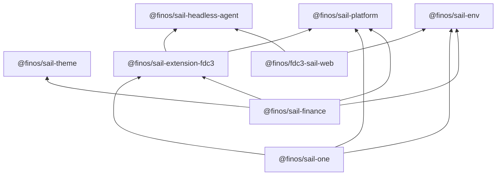

# Packages

How the Sail workspaces relate. The same diagram appears in the repository [README](https://github.com/finos/FDC3-Sail#packages-and-apps); this page is the docs entry point for per-package guides.

| Package | Role |
|---|---|
| [@finos/sail-headless-agent](./headless-agent/overview) | FDC3 engine — 2.2 / 3.0 DACP handlers (`FDC3ServerInstance`) |
| `@finos/sail-extension-fdc3` (`extensions/fdc3`) | Browser Desktop Agent extension — factory, channels, WCP, app directory |
| [@finos/sail-platform](./platform/overview) | Workspaces, layouts, pluggable storage (no FDC3 dependency) |
| [@finos/sail-theme](./sail-theme/overview) | Shared brand tokens and assets |
| [@finos/sail-env](./sail-env/overview) | Shared host URL/env helpers (`appId`, directory, auto-resolve, max FDC3 version) |
| [@finos/sail-finance](./sail-finance/overview) | Example shell — finance-specific workspace |
| [@finos/sail-one](./sail-one/overview) | Example shell — domain-neutral tab-and-grid canvas |
| [@finos/fdc3-sail-web](./sail-v2-web/overview) | Previous Socket.IO Sail UI (still runnable; shares the headless engine) |
| [@finos/sail-conformance-harness](./conformance-harness/overview) | Playwright runner (pending migration; product hosts already use `sail.fdc3`) |

## Two different test signals

See the architecture overview and conformance harness docs for how Cucumber (engine) and Playwright (product hosts) relate.
