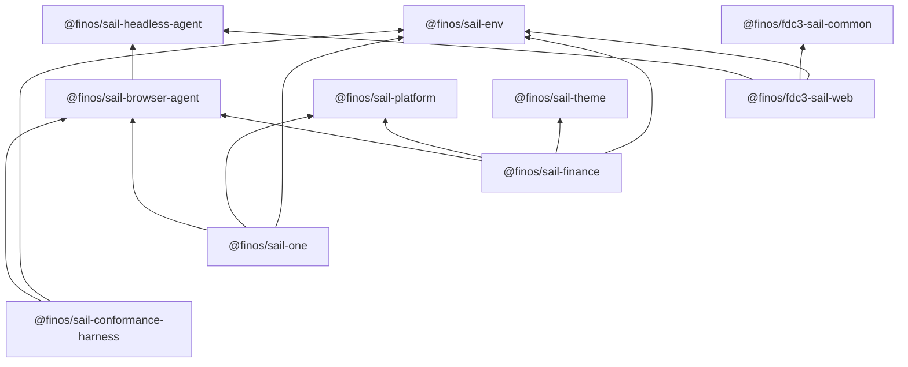

# Packages

How the Sail workspaces relate. The same diagram appears in the repository [README](https://github.com/finos/FDC3-Sail#packages-and-apps); this page is the docs entry point for per-package guides.

| Package | Role |
|---|---|
| [@finos/sail-headless-agent](./headless-agent/overview) | FDC3 engine — 2.2 / 3.0 DACP handlers (`FDC3ServerInstance`) |
| [@finos/sail-browser-agent](./browser-agent/overview) | Browser host for that engine — WCP, MessagePorts, host contracts |
| [@finos/sail-platform](./platform/overview) | Workspaces, layouts, pluggable storage (no FDC3 dependency) |
| [@finos/sail-theme](./sail-theme/overview) | Shared brand tokens and assets |
| [@finos/sail-env](./sail-env/overview) | Shared host URL/env helpers (`appId`, directory, auto-resolve, max FDC3 version) |
| [@finos/sail-finance](./sail-finance/overview) | Example shell — finance-specific workspace |
| [@finos/sail-one](./sail-one/overview) | Example shell — domain-neutral tab-and-grid canvas |
| [@finos/fdc3-sail-web](./sail-v2-web/overview) | Previous Socket.IO Sail UI (still runnable; shares the headless engine) |
| [@finos/sail-conformance-harness](./conformance-harness/overview) | Playwright runner for the FINOS FDC3 conformance toolbox against product hosts |

## Two different test signals

Do not conflate these:

| Signal | What it tests | Where it lives |
|---|---|---|
| **Cucumber BDD** | Engine / DACP messaging (`MockTransport`) for wire **2.2** and **3.0** | [`sail-headless-agent` BDD inventory](./headless-agent/bdd) |
| **FINOS conformance toolbox** | Live browser / WCP behaviour of **product hosts** | [`sail-conformance-harness`](./conformance-harness/overview) — matrix over `sail-one`, `sail-finance`, and `sail-v2-web` (`@finos/fdc3-sail-web`) |
